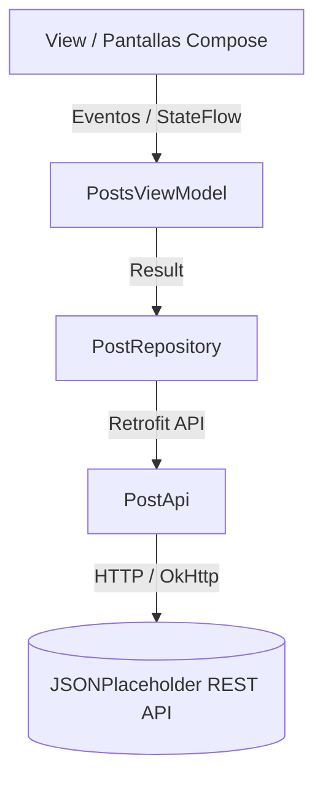

# MuroCampus

**MuroCampus** es una aplicación Android desarrollada para el curso de Programación en Móviles (4to Ciclo), que consume el servicio web REST de [JSONPlaceholder](https://jsonplaceholder.typicode.com/) para listar publicaciones, ver detalles con sus comentarios, filtrar por usuario, buscar por título, crear y eliminar publicaciones, comportándose correctamente ante fallas de conectividad.

## En funcionamiento


## Estructura de Paquetes

```text
com.suarez.murocampus/
├── MainActivity.kt
├── model/
│   └── Modelos.kt (Usuario, Post, Comentario, NuevoPost, DetalleUi)
├── data/
│   ├── remote/
│   │   ├── PostApi.kt
│   │   └── RetrofitClient.kt
│   └── PostRepository.kt (PostRepository, PostRepositoryRemote)
├── viewmodel/
│   ├── UiState.kt
│   ├── PostsViewModel.kt
│   └── PostsViewModelFactory.kt
└── ui/
    ├── Componentes.kt
    ├── PantallaLista.kt
    ├── PantallaDetalle.kt
    ├── PantallaCrear.kt
    └── theme/
```

## Arquitectura MVVM + Repository



- **View:** Pantallas construidas con Jetpack Compose que observan el `StateFlow<UiState<T>>` del `ViewModel` usando `collectAsStateWithLifecycle()`. No conocen Retrofit ni excepciones de red.
- **ViewModel:** Gestiona el estado de la UI (`Cargando`, `Éxito`, `Error`), invocando al `Repository` dentro de corrutinas (`viewModelScope.launch`).
- **Repository:** Encapsula la fuente de datos remota (`PostApi`) y convierte los errores de operación en `Result.failure`, propagando la cancelación de corrutinas.

---

## Mejoras de la Fase 2

- **Búsqueda:** filtra por título las publicaciones ya descargadas; funciona junto con el filtro por usuario sin hacer una petición por cada texto ingresado.
- **Encabezado HTTP:** un interceptor de OkHttp agrega `Accept: application/json` a todas las solicitudes.
- **Eliminar:** la pantalla de detalle solicita confirmación y envía `DELETE posts/{id}`. El Repository comprueba el código HTTP mediante `Response<Unit>` y devuelve el resultado al ViewModel.

JSONPlaceholder solo simula las eliminaciones: una respuesta exitosa quita la publicación de la lista actual, pero no persiste el cambio en el servidor. Las decisiones y prompts de estas mejoras están en [PROMPTS.md](PROMPTS.md).

---

## Respuestas a "Para pensar"

1. **¿Qué diferencia hay entre GET y POST? ¿Por qué crear lleva @Body y por Usuario lleva @Query?**
   - **GET** se utiliza para solicitar la lectura o recuperación de recursos del servidor sin alterar su estado, mientras que **POST** se utiliza para enviar datos al servidor con el fin de crear un nuevo recurso.
   - Crear lleva `@Body` porque el objeto `NuevoPost` debe serializarse como JSON en el cuerpo (`body`) de la petición HTTP POST. En cambio, porUsuario lleva `@Query` porque el filtro de usuario se envía como un parámetro de consulta en la URL (ej. `posts?userId=2`).

2. **¿Por qué la ruta es "posts" y no "/posts"?**
   - En Retrofit, si una ruta relativa comienza con una barra diagonal (`/`), Retrofit la interpreta como una ruta absoluta que reemplaza la ruta base completa configurada en el cliente Retrofit (ignorando el segmento base). Al no llevar barra inicial (`posts`), se concatena correctamente con la `baseUrl` (ej. `https://jsonplaceholder.typicode.com/posts`).

3. **¿Por qué el Repository devuelve Result en vez de dejar que la excepción llegue al ViewModel?**
   - Permite separar el manejo de errores de red del código de negocio del ViewModel y la UI. Al retornar un `Result<T>`, el Repository atrapa excepciones (como `IOException` o `HttpException`) de forma centralizada y devuelve explícitamente un fallo, evitando que excepciones no controladas crasheen la app y facilitando un manejo de estados reactivo y robusto.

4. **¿Qué pasa si olvidas el permiso INTERNET? ¿Y si olvidas ignoreUnknownKeys y el servidor agrega un campo nuevo?**
   - Si se olvida el permiso `INTERNET` en el `AndroidManifest.xml`, la aplicación no podrá establecer conexiones de red y arrojará una excepción de tipo `UnknownHostException` (sin conexión).
   - Si se omite `ignoreUnknownKeys = true` en el serializador de JSON y el servidor añade un campo nuevo inesperado en la respuesta JSON, la deserialización fallará lanzando una excepción `SerializationException` (respuesta inesperada).

5. **¿Por qué la pantalla de lista usa un when sobre UiState y no un if con tres variables?**
   - El uso de `when` sobre una interfaz sellada (`UiState`) garantiza exhaustividad en el manejo de estados (`Cargando`, `Exito`, `Error`) de manera declarativa y segura en tiempo de compilación. Un `if` con múltiples variables independientes sería propenso a estados inválidos o inconsistentes (ej. estar cargando y tener error al mismo tiempo).

6. **JSONPlaceholder no guarda los POST. ¿Cómo cambiaría tu app si usaras un servicio real?**
   - En un servicio web real, la respuesta del `POST` devolvería el objeto recién creado con su ID generado por la base de datos persistente del servidor. Además, tras un `POST` exitoso, la app debería actualizar su estado local o volver a recargar el listado desde el repositorio para reflejar la nueva publicación en pantalla (o persistirla localmente usando una base de datos como Room).
