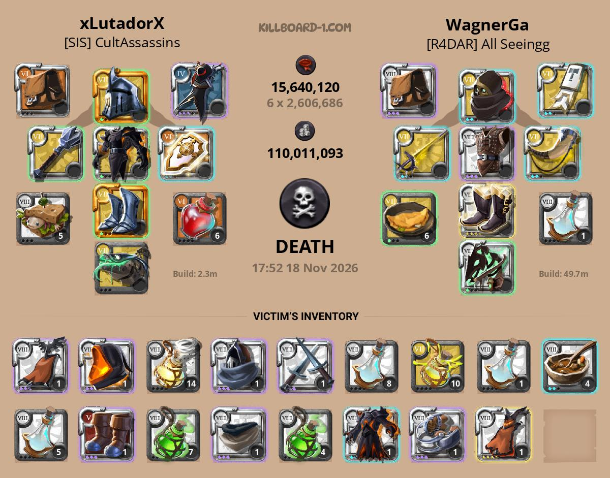

# CampusGPS

App Android (Kotlin + Jetpack Compose + Material 3) desarrollada para el **Laboratorio 13** de Programación en Móviles. Obtiene la ubicación actual del dispositivo, la muestra en un mapa interactivo utilizando Google Maps Compose y calcula la distancia a cinco puntos ficticios del campus (ordenados de menor a mayor distancia).

## Estructura de paquetes
```
com.tecsup.campusgps/
├── MainActivity.kt
├── model/      Modelos.kt (Posicion, Lugar, LugarConDistancia, TipoError, UbicacionUi)
├── data/       UbicacionRepository (+ Google), LugaresRepository (+ Local)
├── util/       Distancia.kt, Formato.kt
├── viewmodel/  MapaViewModel.kt, CampusViewModelFactory.kt
└── ui/         PantallaMapa, MapaUbicacion, ListaLugares, MensajeError, theme/
```

## Arquitectura MVVM + Repository
```
View (PantallaMapa) --evento--> ViewModel (MapaViewModel) --StateFlow--> View (collectAsState)
ViewModel --> UbicacionRepository ---> UbicacionRepositoryGoogle (FusedLocationProviderClient)
ViewModel --> LugaresRepository   ---> LugaresRepositoryLocal (5 lugares fijos)
```

## Capturas


## Para pensar

1. **¿Por qué FusedLocationProviderClient está en el Repository y no en el ViewModel?**
   Porque es una dependencia de Android/Google Play Services que necesita un `Context`. El ViewModel solo conoce la interfaz abstracta (`UbicacionRepository`), por lo que no depende de Android, permitiendo pruebas unitarias con un repositorio falso y facilitando cambios en la fuente de ubicación.

2. **Diferencia entre permiso de ubicación y clave de API.**
   El permiso lo concede el usuario para que la app lea su ubicación física; si falta, la app muestra un error de permisos pero sigue abierta. La clave de API identifica a la app ante los servidores de Google Maps; si falta o es incorrecta, el mapa se muestra en gris o la app falla al cargar las baldosas.

3. **¿Por qué la clave va en local.properties y no en el código?**
   Para evitar subir credenciales privadas a repositorios públicos de GitHub. Si se sube por error, la clave queda expuesta, obligando a revocarla en Google Cloud, generar una nueva y asegurar que `local.properties` esté listado en `.gitignore`.

4. **¿Dónde se calcula la distancia y por qué no en el Composable?**
   Se calcula en el ViewModel (`actualizarDistancias`), utilizando funciones puras dentro de `util/`. Un Composable se recompone frecuentemente y debe limitarse exclusivamente a representar el estado visual; realizar cálculos complejos en la interfaz rompe el patrón MVVM y afecta el rendimiento.

5. **¿Qué pasa con tu app si el usuario niega el permiso dos veces? ¿Cómo lo manejas?**
   Android oculta el cuadro de diálogo del sistema (negación permanente). La app maneja este estado detectándolo y mostrando la pantalla de error correspondiente con el botón **"Abrir ajustes"**, el cual redirige al usuario directamente a la configuración de la aplicación en el sistema operativo para habilitar el permiso de forma manual.
