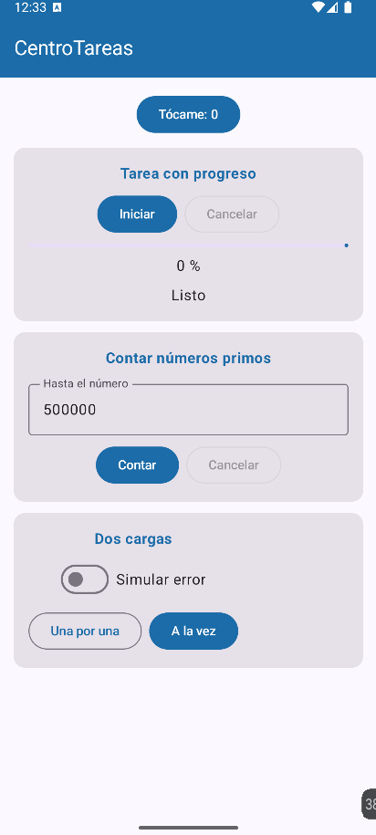

# CentroTareas

App Android (Kotlin + Jetpack Compose + Material 3) que demuestra cómo mantener el hilo principal libre usando corrutinas: tarea con progreso y cancelación, cálculo de números primos y dos cargas simuladas (secuencial vs. paralela), con manejo de errores. Arquitectura **MVVM + Repository**. Datos 100 % ficticios.

## Árbol de paquetes
```
com.tecsup.centrotareas/
├── MainActivity.kt
├── model/        Estados.kt (PrimosUi, CargaUi)
├── data/         TareasRepository.kt, TareasRepositoryLocal.kt
├── viewmodel/    TareasViewModel.kt, TareasViewModelFactory.kt
└── ui/           PantallaTareas.kt, theme/
```

## Diagrama MVVM
```
View (PantallaTareas)
   | eventos                ^ collectAsState()
   v                        |
ViewModel (TareasViewModel) --- StateFlow --->
   | viewModelScope.launch { ... }
   v
TareasRepository (interface) ---> TareasRepositoryLocal
   (cargas simuladas y contar primos)
```

## Observación del Paso 1
Al tocar **Tarea larga (MAL)**, toda la pantalla se congeló durante 4 segundos: el botón **Tócame** no sumaba y el texto "Trabajando..." nunca apareció. Esto ocurre porque `Thread.sleep(4000)` se ejecutó en el hilo principal, que es el mismo que dibuja la interfaz; mientras estaba dormido no pudo recomponer ni atender toques. El mensaje cambió a "Trabajando..." y luego a "Terminó" antes de que se dibujara un solo fotograma, así que solo se vio el resultado final. Si la espera fuera de 10 segundos, Android mostraría el diálogo **"La aplicación no responde" (ANR)**, que se dispara cuando el hilo principal está bloqueado unos 5 segundos y ofrece cerrar la app.

## Capturas


## Para pensar
1. **¿Por qué no se veía "Trabajando..." en el Paso 1?** Porque el hilo principal estaba bloqueado por `Thread.sleep`; el cambio de estado ocurrió, pero Compose no pudo redibujar hasta que la función terminó, y para entonces el mensaje ya era "Terminó".
2. **¿Diferencia entre `Thread.sleep` y `delay`?** `Thread.sleep` bloquea el hilo completo y no responde a la cancelación de la corrutina. `delay` es una función `suspend`: suspende solo la corrutina, libera el hilo para otras tareas y revisa la cancelación.
3. **¿Por qué `Dispatchers.Default` para los primos y `Dispatchers.IO` para la red?** Default tiene tantos hilos como núcleos de CPU y está pensado para trabajo que consume procesador; más hilos no ayudarían. IO tiene un pool grande y elástico, adecuado para operaciones que pasan la mayor parte del tiempo esperando (red, disco), donde conviene tener muchas en espera a la vez.
4. **¿Qué pasa con la corrutina si el usuario cierra la pantalla?** `viewModelScope` se cancela automáticamente cuando el ViewModel se destruye (`onCleared`), cancelando todas sus corrutinas y evitando fugas de memoria o trabajo inútil. Al rotar la pantalla el ViewModel sobrevive, por eso la tarea continúa.
5. **¿Por qué `async` tarda 3 s y no 5 s?** Las dos cargas corren al mismo tiempo, así que el total es el máximo (3 s) y no la suma (2 s + 3 s). Si una falla, `coroutineScope` cancela a la otra y relanza la excepción, que el `try/catch` convierte en el estado `Error`.

---

# Fase 2 · Mejoras con IA (rama `mejora-ia`)

| # | Mejora | Capas | Dónde |
|---|--------|-------|-------|
| 1 | **Progreso desde el Repository** con `Flow` + `flowOn(Dispatchers.Default)` | Repository + ViewModel | `TareasRepository.tareaConProgreso()` |
| 2 | **Reintento automático** (3 intentos, espera 1 s → 2 s) solo ante `IOException` | ViewModel + View | `conReintentos()` en `TareasViewModel` |
| 3 | **Comparación de tiempos** acumulada de *Una por una* vs *A la vez* | ViewModel + View | `Comparacion` + `TarjetaComparacion` |

Detalles:
- El ViewModel ya no hace trabajo: solo `collect` del Flow del Repository.
- Con **Simular error** activado, la carga hace 3 intentos (cada uno ≈ 3 s + esperas), así que el recuadro rojo aparece tras ~10 s. La tarjeta muestra "Reintentando (intento 2 de 3)...".
- La comparación se llena solo con cargas exitosas. Haz varias de cada modo y pulsa **Limpiar** para reiniciar.
- Ver `PROMPTS.md` para el registro de uso de Gemini.
