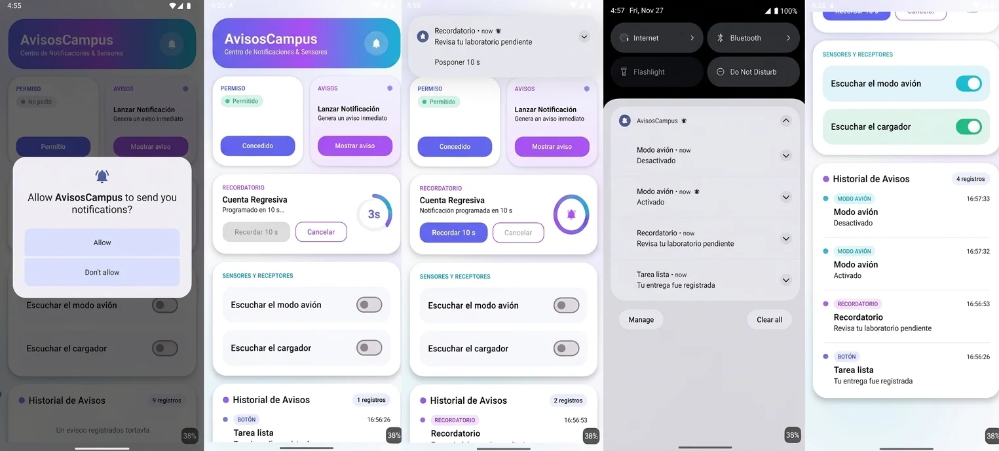

# AvisosCampus

App Android (Kotlin + Jetpack Compose + Material 3) que muestra notificaciones locales,
programa un recordatorio con corrutinas y escucha el modo avión con un `BroadcastReceiver`.
Patrón **MVVM + Repository**.

## Capturas de funcionamiento



## Estructura de paquetes
```
com.tecsup.avisoscampus/
├── AvisosApp.kt              Application: crea el canal
├── MainActivity.kt
├── model/Modelos.kt          Aviso, Origen, PermisoUi
├── data/AvisosRepository.kt  interface + AvisosRepositoryMemoria
├── notificacion/Notificador.kt
├── receiver/ModoAvionReceiver.kt
├── viewmodel/                AvisosViewModel + Factory
└── ui/                       PantallaAvisos, HistorialAvisos, theme/
```

## Diagrama MVVM
```
View (PantallaAvisos)
  | eventos: botones, switch            ^ collectAsState()
  v                                     |
ViewModel (AvisosViewModel) --- StateFlow (avisos, permiso, faltan...) --->
  | registra el aviso                   | emite: eventos (SharedFlow<Aviso>)
  v                                     v
AvisosRepository (interface)        View recibe el evento y llama a
  -> AvisosRepositoryMemoria        Notificador.mostrar(context, aviso)
```

## Capturas
(Agrega aquí tus 5 capturas: notificación en el panel, recordatorio, modo avión, historial y permiso denegado)

## Para pensar
1. **Canal y permiso:** el canal (Android 8+) agrupa y define la importancia/sonido de las notificaciones; sin canal, en API 26+ la notificación no se muestra. El permiso POST_NOTIFICATIONS (Android 13+) autoriza a la app a mostrarlas; sin él, `notify` no muestra nada.
2. **Evento en vez de mostrar:** el ViewModel no debe tener `Context` ni tocar el sistema; así sobrevive a rotaciones y se puede probar sin Android. La pantalla, que sí tiene Context, muestra la notificación.
3. **Mismo id:** la segunda notificación reemplaza a la primera; solo se vería una.
4. **onReceive corto / quitar receptor:** onReceive corre en el hilo principal y el sistema puede matar el proceso si tarda. Si no se quita el receptor (`unregisterReceiver`) se filtra memoria y se sigue escuchando sin necesidad.
5. **Local vs push:** local para avisos que genera la propia app (recordatorios, eventos del dispositivo); push de Firebase cuando el aviso viene de un servidor y debe llegar con la app cerrada.

---

# Fase 2 · Mejoras (rama `mejora-ia`)

| # | Mejora | Capas que cambian |
|---|--------|-------------------|
| 1 | Dos canales: **Avisos** (normal) y **Urgentes** (`IMPORTANCE_HIGH`, emergente). El recordatorio usa Urgentes | Notificador |
| 2 | Texto largo con `BigTextStyle` al expandir la notificación | Notificador |
| 3 | Botón **Posponer 10 s** (`addAction` + `PendingIntent.getBroadcast` a `PosponerReceiver`) | Notificador + Receiver + ViewModel |
| 4 | Receptor del cargador (`ACTION_POWER_CONNECTED/DISCONNECTED`) con su propio switch | Receiver + ViewModel + View |

Cómo probar el cargador en el emulador: ⋮ (Extended controls) → Battery → *Charger connection*.
Cómo probar Posponer: pulsa *Recordar en 10 s*, espera la notificación emergente, expándela y toca *Posponer 10 s*.

Limitación conocida: Posponer funciona mientras el proceso de la app siga vivo (el ViewModel recibe la señal).
Para que funcione con la app muerta habría que usar `AlarmManager` o `WorkManager`.
